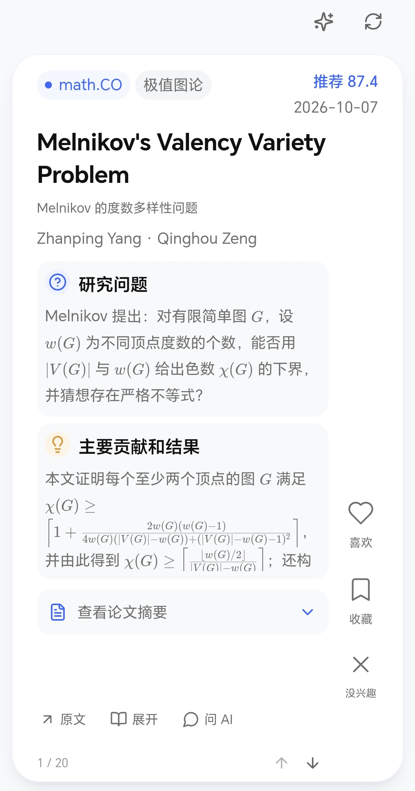
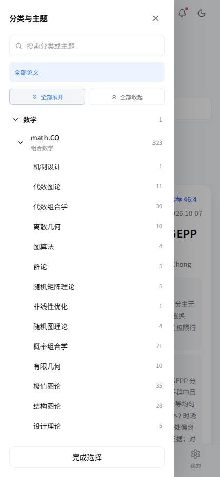
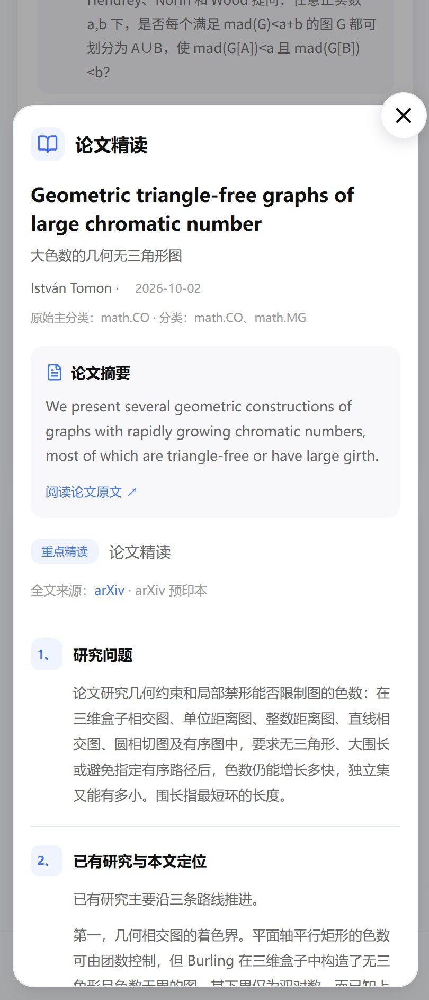
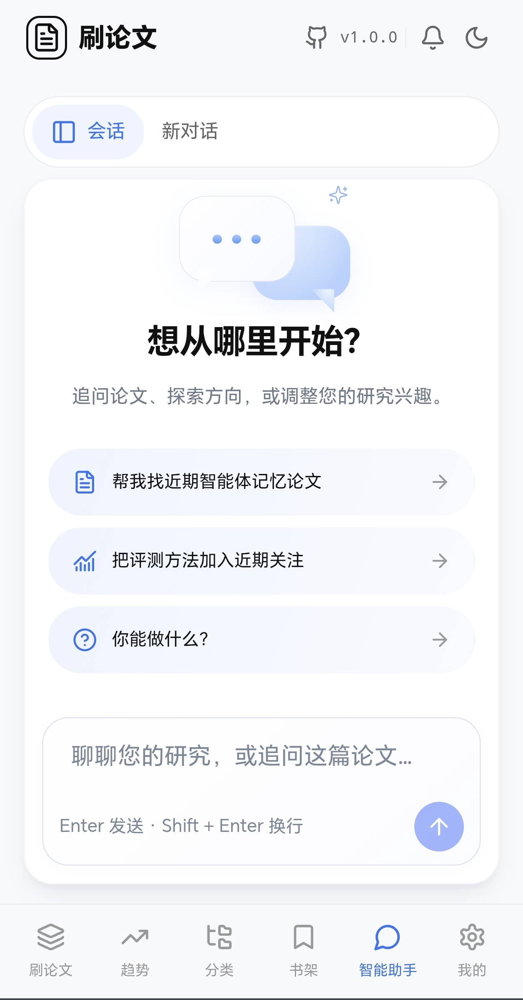
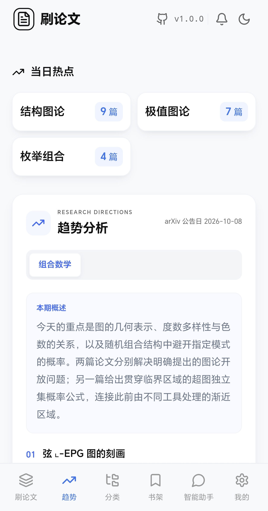
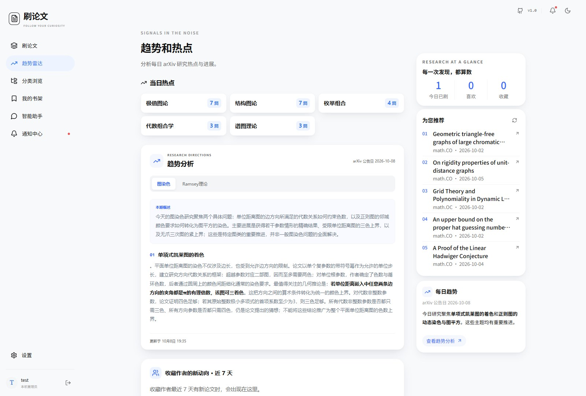

<div align="center">
  
  <h1>Papers-Go</h1>
  <p>Discover papers, find research directions, and read with an AI assistant.</p>
  <p>
    <a href="https://github.com/cyhcyh/Papers-Go"></a>
    <a href="LICENSE"></a>
    <a href="https://hub.docker.com/r/roger1001/papers-go"></a>
  </p>
  <p><a href="README.md">简体中文</a> · <strong>English</strong>　｜　<a href="docs/en/index.md">Documentation</a> · <a href="docs/en/quick-start.md">Quick Start</a></p>
</div>

Papers-Go is a self-hosted paper reading and recommendation website with a browsing experience inspired by short-video feeds. It synchronizes arXiv and conference papers, recommends research based on your interests, generates reading cards on demand, and analyzes developments using recent papers. Use local Ollama or connect cloud models; administrators can assign a different model to each feature.

## Features

- **Paper feed:** a two-column desktop feed and vertical mobile browsing. Cards show original titles, Chinese translations, authors, recommendation scores, and the research question and main contribution/results. Like, save, or mark papers as uninteresting. Mathematical notation is supported.
- **Interest-based recommendations:** filter by categories, topics, and research interests. Continued reading and feedback inform recommendations. Guests can browse the administrator's default sources.
- **Category browsing:** organize papers by discipline, arXiv category or conference, and research topic. Search, filter by date, and propose topics. Administrators approve or directly add official topics.
- **Paper reading:** generate six-question cards from full text, with lists, tables, and LaTeX. Generation continues in a background queue after the page closes. Completed cards are reusable by other users.
- **Research trends:** short home-page summaries of daily research focus and developments, with fuller analysis and recent-research context on the trends page.
- **Research assistant:** streaming multi-turn conversations with paper search and reading tools. Interest and watch-list changes require user confirmation. Tool access is scoped to the user.
- **Agent Skills:** standard skill packages with personal skills, sharing proposals, versions, and on-demand loading. The assistant can create personal skills; shared publication requires administrator approval.
- **Administration:** site settings, data charts, cloud token usage, source and topic management, users, logs, task controls, and configuration for models, Prompts, and Skills.

The current application interface is primarily Chinese. The English manual includes Chinese menu labels to help you find each control.

## Screenshots

<p> </p>

<details>
<summary>Mobile: feed, category drawer, reading, assistant, and trends</summary>

<p> </p>
<p> </p>
<p></p>
</details>

<details>
<summary>Category browsing</summary>
<p></p>
</details>

<details>
<summary>Reading cards</summary>
<p></p>
</details>

<details>
<summary>Research trends</summary>
<p></p>
</details>

<details>
<summary>Research assistant</summary>
<p></p>
</details>

<details>
<summary>Administration overview</summary>
<p></p>
</details>

<details>
<summary>Topic management</summary>
<p></p>
</details>

<details>
<summary>Model configuration</summary>
<p> </p>
</details>

## Contents

- [Quick deployment](#quick-start)
- [First use](#first-use)
- [Configuration](#configuration)
- [Updates and backups](#updates-and-backups)
- [Local development](#development)
- [Technology and project layout](#project-structure)
- [Roadmap](#todo)
- [License](#license)

For a complete walkthrough, see the [English quick start](docs/en/quick-start.md) and [user manual](docs/en/index.md).

<a name="quick-start" id="quick-start"></a>

## Quick deployment

Install Docker and Docker Compose 2.30 or newer. The [Docker Hub image](https://hub.docker.com/r/roger1001/papers-go) does not require source code, Python, or Node.js on the host. It currently supports `linux/amd64`, suitable for common x86 Linux servers and x86 Docker Desktop installations using Linux containers.

```bash
mkdir Papers-Go
cd Papers-Go
```

Choose one of the complete configurations below, save it as `docker-compose.yml` in the deployment directory, and run its startup commands. An `.env` file is optional. Configure model connections and selections in the administration console.

**The examples below are for new installations. Existing sites should keep their current Compose configuration and update only the images. Retain the original project name, ports, data directory, key directory, and model volume. Do not replace an existing configuration with a fresh-install example.**

### Option 1: Application only

Use an existing Ollama service or a cloud API. This configuration starts the website and background worker.

```yaml
name: papers-go
services:
  app:
    image: roger1001/papers-go:latest
    ports:
      - "8000:8000"
    env_file:
      - path: .env
        required: false
    environment:
      DATA_DIR: /data
      FRONTEND_DIR: /app/frontend/dist
      MODEL_KEY_FILE: /secrets/model-keys.key
      OLLAMA_BASE_URL: ${OLLAMA_BASE_URL:-http://ollama:11434}
      TZ: ${TZ:-Asia/Shanghai}
      PIPELINE_MODE: external
    extra_hosts:
      - "host.docker.internal:host-gateway"
    volumes:
      - ./data:/data
      - ./.secrets:/secrets
    restart: unless-stopped
    logging:
      driver: json-file
      options:
        max-size: "10m"
        max-file: "3"
    healthcheck:
      test: ["CMD", "python", "-c", "import urllib.request; urllib.request.urlopen('http://localhost:8000/api/health')"]
      interval: 30s
      timeout: 5s
      retries: 3
  worker:
    image: roger1001/papers-go:latest
    command: ["python", "-m", "app.worker"]
    env_file:
      - path: .env
        required: false
    environment:
      DATA_DIR: /data
      FRONTEND_DIR: /app/frontend/dist
      MODEL_KEY_FILE: /secrets/model-keys.key
      OLLAMA_BASE_URL: ${OLLAMA_BASE_URL:-http://ollama:11434}
      TZ: ${TZ:-Asia/Shanghai}
      PIPELINE_MODE: external
    extra_hosts:
      - "host.docker.internal:host-gateway"
    volumes:
      - ./data:/data
      - ./.secrets:/secrets
    depends_on:
      app:
        condition: service_healthy
    restart: unless-stopped
    logging:
      driver: json-file
      options:
        max-size: "10m"
        max-file: "3"
```

```bash
docker compose pull
docker compose up -d
```

Open [http://localhost:8000](http://localhost:8000). After first registration, add connections and assign models under **模型配置**. For Ollama on the Docker host, enter `http://host.docker.internal:11434`. For another device, use its reachable address. Ollama must accept connections from the application container.

### Option 2: Application and Ollama with GPU

This option requires an NVIDIA GPU available to Docker. Linux hosts need NVIDIA Container Toolkit, and GPU configuration requires Docker Compose 2.30 or newer. It starts Ollama without selecting or downloading models.

```yaml
name: papers-go
services:
  app:
    image: roger1001/papers-go:latest
    ports:
      - "8000:8000"
    env_file:
      - path: .env
        required: false
    environment:
      DATA_DIR: /data
      FRONTEND_DIR: /app/frontend/dist
      MODEL_KEY_FILE: /secrets/model-keys.key
      OLLAMA_BASE_URL: ${OLLAMA_BASE_URL:-http://ollama:11434}
      TZ: ${TZ:-Asia/Shanghai}
      PIPELINE_MODE: external
    extra_hosts:
      - "host.docker.internal:host-gateway"
    volumes:
      - ./data:/data
      - ./.secrets:/secrets
    restart: unless-stopped
    logging:
      driver: json-file
      options:
        max-size: "10m"
        max-file: "3"
    healthcheck:
      test: ["CMD", "python", "-c", "import urllib.request; urllib.request.urlopen('http://localhost:8000/api/health')"]
      interval: 30s
      timeout: 5s
      retries: 3
  worker:
    image: roger1001/papers-go:latest
    command: ["python", "-m", "app.worker"]
    env_file:
      - path: .env
        required: false
    environment:
      DATA_DIR: /data
      FRONTEND_DIR: /app/frontend/dist
      MODEL_KEY_FILE: /secrets/model-keys.key
      OLLAMA_BASE_URL: ${OLLAMA_BASE_URL:-http://ollama:11434}
      TZ: ${TZ:-Asia/Shanghai}
      PIPELINE_MODE: external
    extra_hosts:
      - "host.docker.internal:host-gateway"
    volumes:
      - ./data:/data
      - ./.secrets:/secrets
    depends_on:
      app:
        condition: service_healthy
    restart: unless-stopped
    logging:
      driver: json-file
      options:
        max-size: "10m"
        max-file: "3"
  ollama:
    gpus: all
    image: ollama/ollama:0.11.11
    ports:
      - "${OLLAMA_BIND:-127.0.0.1}:${OLLAMA_PORT:-11434}:11434"
    environment:
      OLLAMA_NUM_PARALLEL: "1"
      OLLAMA_MAX_LOADED_MODELS: "1"
    volumes:
      - ollama:/root/.ollama
    restart: unless-stopped
    logging:
      driver: json-file
      options:
        max-size: "10m"
        max-file: "3"
volumes:
  ollama:
```

```bash
docker compose pull
docker compose up -d
```

Open [http://localhost:8000](http://localhost:8000). Use `http://ollama:11434` for the Ollama connection. Prepare models in Ollama, then refresh the model list and assign features in the console. See the [Ollama documentation](https://docs.ollama.com/docker) for service and model management.

If you downloaded the source, the repository also provides split configurations. These files retain the historical default project name for existing deployments:

```bash
docker compose -f docker-compose.yml -f docker-compose.ollama.yml -f docker-compose.gpu.yml pull
docker compose -f docker-compose.yml -f docker-compose.ollama.yml -f docker-compose.gpu.yml up -d
```

If host port `11434` is occupied, change the Ollama host port. Internal connections still use `http://ollama:11434`. Keep the actual project name, data directories, and model volume when switching deployment methods or updating. Changing the project name creates a separate set of containers and may select an empty model volume.

### External access

The default host website port is `8000`. Change the first number in `8000:8000`, for example to `8080:8000`, to use another port. For public access, configure an HTTPS reverse proxy and disable buffering for the assistant's SSE responses. PWA installation requires HTTPS, except for localhost development.

<a name="first-use" id="first-use"></a>

## First use

1. Register the first account; it becomes an administrator. Save the random administration entry shown after registration. You can subsequently view or change it in the console.
2. Under **基本设置**, set the site name, icons, description, and administration entry.
3. Under **分类与来源**, add arXiv categories and conferences and choose automatic ingestion and guest defaults. A fresh installation does not automatically enable all sources or topics.
4. Under **模型配置 → 模型连接**, add local or cloud connections. Under **功能分配**, assign models, thinking settings, and concurrency for each feature.
5. Run ingestion and processing under **任务中心**. Tasks can be independently enabled, stopped, or disabled. Selected processing tasks support reprocessing, with results saved paper by paper.
6. Registered users set their own interests, then browse, save papers, use the assistant, and generate reading cards.

The administration entry is random, and the backend still enforces authentication and permissions. Administrators can change roles and disable accounts. Deleting an account also removes its personal data.

<a name="configuration" id="configuration"></a>

## Configuration

Change the website port in Compose `ports`. Optional `.env` settings cover timezone and runtime parameters; see [.env.example](.env.example). Configure API keys, Ollama URLs, connections, and model assignments in the console.

| Setting | Default | Purpose |
| --- | --- | --- |
| `TZ` | `Asia/Shanghai` | Timezone |
| `OLLAMA_PORT` | `11434` | Ollama host port |
| `OLLAMA_BIND` | `127.0.0.1` | Ollama host bind address |
| `SCHEDULER_ENABLED` | `true` | Enable scheduled background tasks |
| `BOOTSTRAP_ENABLED` | `true` | Enable startup initialization |
| `REQUIRE_INVITE_CODE` | `false` | Require invitation codes for registration |

### Models and instructions

Connections support Ollama, OpenAI-compatible cloud APIs, and Codex device authorization. Refresh available models and assign primary/fallback models and advanced settings per feature. Thinking and reasoning controls depend on model capabilities.

Use **Prompts** to edit instructions for new calls, and **Skills** to manage skill packages and versions. Default prompts are in [backend/app/prompts.toml](backend/app/prompts.toml); the bundled scoring skill is [backend/app/skills/paper-quality/SKILL.md](backend/app/skills/paper-quality/SKILL.md). Console edits do not rewrite these source files.

### Data and credentials

- `data/`: SQLite databases, user data, reading caches, and runtime skill files.
- `.secrets/`: credential encryption key, mounted at `/secrets/model-keys.key` in Docker.
- Docker named volume: downloaded Ollama models. The new-install examples above use `papers-go_ollama`. Existing deployments retain their original model volume, whose actual name depends on the Compose project name.

API keys are encrypted and not returned in plain text by the interface. Back up `data/` and `.secrets/` together. Without the original key, stored model credentials cannot be decrypted. Do not commit `.env`, databases, or encryption keys to a public repository.

Logs redact API keys, Authorization values, and other sensitive fields. Retention is configurable and does not change saved credentials' validity.

<a name="updates-and-backups" id="updates-and-backups"></a>

## Updates and backups

Existing sites do not need to migrate containers or data for this naming update. Keep the current Compose configuration and project name. If installation used `-p` or `COMPOSE_PROJECT_NAME`, retain the same setting for updates, backups, and restoration.

Back up before updating. Stop the application and worker, copy complete `data/`, `.secrets/`, `docker-compose.yml`, and optional `.env` to a safe location, then restart. Keep every file under `data/`, rather than only the main SQLite file. Credentials require the matching encryption key. Also back up active Ollama/GPU overlay files if used.

```bash
docker compose stop worker app
# Copy data/, .secrets/, active Compose files, and optional .env here.
docker compose start app worker
```

Avoid opening the actively written Docker database with host-side SQLite tools. Use the administration interface for routine queries and management.

With either complete Compose configuration above, update the application as follows:

```bash
docker compose pull app worker
docker compose up -d --no-deps app worker
```

With the repository's split GPU configuration, keep its file arguments:

```bash
docker compose -f docker-compose.yml -f docker-compose.ollama.yml -f docker-compose.gpu.yml pull app worker
docker compose -f docker-compose.yml -f docker-compose.ollama.yml -f docker-compose.gpu.yml up -d --no-deps app worker
```

These commands update the application and worker while retaining Ollama and its model cache. `latest` follows the newest release. To pin a version, set both application images to the same published Docker Hub tag.

To restore, stop the application and worker, restore matching data, keys, and configuration, and run `docker compose up -d` with the original overlay arguments if used. Keep the project name, mounts, and model volume. Do not use `docker compose down -v`; it removes the Ollama model volume. That named volume is not included in the directory backup described above.

<a name="development" id="development"></a>

## Local development

Install Git, Conda, and Node.js 22, then download the source:

```bash
git clone https://github.com/cyhcyh/Papers-Go.git
cd Papers-Go
```

From the project root:

```bash
conda env create --prefix ./.conda-env -f environment.yml
conda activate ./.conda-env
```

Copy `.env.example` to `.env` (`Copy-Item .env.example .env` in PowerShell, or `cp .env.example .env` in Bash).

For host-native development, configure Ollama as `http://localhost:11434`, or add a cloud connection, then assign models in the console.

Start the backend:

```bash
python -m uvicorn app.main:app --app-dir backend --host 127.0.0.1 --port 8000 --reload
```

Start the frontend in another terminal:

```bash
cd frontend
npm ci
npm run dev
```

Open Vite's displayed address, normally [http://127.0.0.1:5173](http://127.0.0.1:5173). Its proxy connects to backend port `8000`.

<a name="project-structure" id="project-structure"></a>

## Technology and project layout

| Component | Technology |
| --- | --- |
| Frontend | React, TypeScript, Vite, assistant-ui, KaTeX, Recharts |
| Backend | Python 3.12, FastAPI, SQLite, sqlite-vec |
| Models | Ollama, OpenAI-compatible APIs, Codex device authorization |
| Deployment | Docker Compose, separate background worker, Conda |

```text
Papers-Go/
├── backend/                 # APIs, recommendations, model routing, and background tasks
│   └── app/
│       ├── prompts.toml     # Default prompts
│       └── skills/          # System Agent Skills
├── frontend/                # Web and mobile interface
├── docs/                    # Chinese/English manuals and interface screenshots
├── docker-compose.yml       # Application and worker
├── docker-compose.ollama.yml # Optional Ollama service, also usable independently
├── docker-compose.gpu.yml    # Optional NVIDIA GPU configuration
├── .env.example             # Runtime settings example
└── LICENSE
```

<a name="todo" id="todo"></a>

## Roadmap

- [ ] Refactor database interfaces and migrate to PostgreSQL.
- [ ] Add SMTP email support.
- [ ] Support additional models and token plans, including Claude.
- [ ] Add notification channels such as Feishu.
- [ ] Let the assistant deliver daily research briefs.
- [ ] Allow ordinary users to configure their own model APIs.

<a name="license" id="license"></a>

## License

This project uses the [GNU Affero General Public License v3.0 (AGPL-3.0)](LICENSE). When distributing modified versions or providing a modified version as a network service, follow the license's corresponding source-availability requirements.

Third-party dependencies retain their respective licenses. PyMuPDF offers AGPL and commercial licensing; see [PyMuPDF licensing](https://pymupdf.readthedocs.io/en/latest/about.html#license-and-copyright). UI component notices are preserved in [frontend/public/third-party-ui-licenses.txt](frontend/public/third-party-ui-licenses.txt).

Report problems through [Issues](https://github.com/cyhcyh/Papers-Go/issues), or contribute a Pull Request.

## Acknowledgments

Conference ingestion uses feeds provided by [bojone/papers.cool](https://github.com/bojone/papers.cool). Its reading features also inspired the paper reading cards in this project. Thank you.

