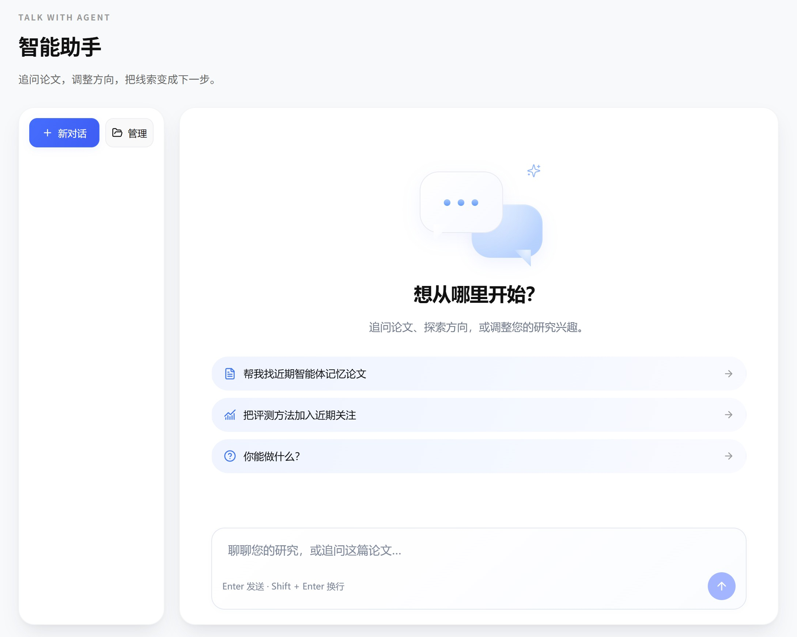

# Research assistant and Skills

[Contents](index.md) · [简体中文](../zh/assistant.md)

## Start a conversation

Open **智能助手**, or choose **问 AI** on a paper card. Login and an assigned assistant model are required.

1. Select **新对话** and enter your research question.
2. Press Enter to send or Shift + Enter for a new line.
3. When starting from a paper, specify the method, formula, or result you want explained.
4. Response text appears progressively. Internal model reasoning is hidden.

Responses support Markdown, lists, tables, and mathematics. Paper references help you return to relevant papers.

## Manage conversations

Use the conversation list on desktop or the collapsible history drawer on mobile. Select multiple conversations for batch management and deletion.

Deleting a conversation removes its history; refreshing cannot restore it. Shared papers and reading caches are not removed with a personal conversation.

## Available capabilities

| Capability | Purpose |
| --- | --- |
| Search papers | Search the collection already ingested by this installation |
| Request reading | Queue a paper or retrieve an existing reading result |
| View interests | Use the current user's profile as context |
| Propose interest changes | Present changes for user confirmation before saving |
| Propose a watch | Present a new watch for confirmation |
| Use skills | Discover, read, and activate accessible skills |
| Create personal skills | Create or edit the user's own skills and submit sharing proposals |

Tool identity comes from the authenticated session, not an identity chosen by the model. The assistant has no general-purpose tool for administering the site, editing another user's records, or executing system commands. Shared paper search and private user-data access have different scopes.

Review interest or watch proposals before accepting or rejecting them. Explanatory advice alone does not automatically change your saved interests.

## Context and memory

Messages are stored in your conversation. The assistant uses your current profile, paper context, tool results, and skills loaded as needed. A separately assigned **上下文压缩** model can summarize earlier material in long conversations.

Persistent research preferences live in the interest profile. Paper and interest vectors support retrieval and recommendations. A conversation does not permanently train the model; save directions in interest settings when they should persist.

## Personal skills

Open **设置 → 我的技能**. A skill contains instructions and optional resources for a research workflow, such as comparing assumptions, methods, and results across two papers.

1. Create a skill with a name, description, instructions, and optional resources.
2. Save and enable it.
3. Ask the assistant to use it; the assistant can read and activate it when needed.
4. Submit a sharing proposal if other users should have access. Administrators approve publication.

Personal skills stay within their permitted personal scope. Administrators maintain shared and system skills. A skill's instructions do not grant additional administrative privileges: tool and identity restrictions still apply.

## Administrator skill management

Admin → **模型配置 → Skills** manages system skills, shared proposals, and versions. The bundled quality-assessment skill is at `backend/app/skills/paper-quality/SKILL.md`; console edits are saved as runtime configuration.

Changes apply to new calls. Version history is bounded and does not replace a complete data backup.

[Previous: Paper reading](reading.md) · [Next: Trends and hotspots](trends.md)
