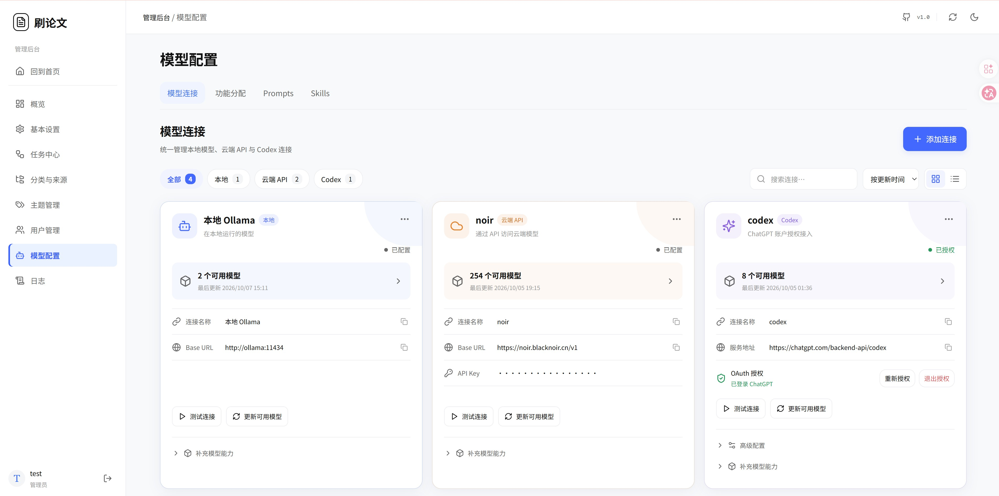
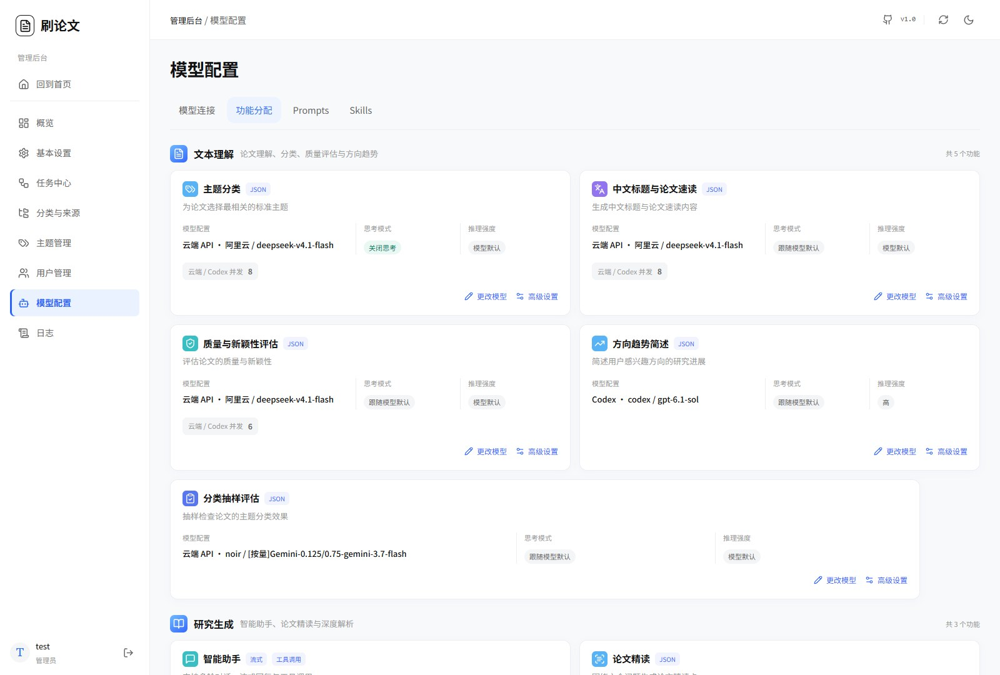

# Model configuration

[Contents](index.md) · [简体中文](../zh/models-prompts.md)

First configure connections and feature assignments. Keep Prompts and Skills at their defaults until the basic workflow works.

Open Admin → **模型配置**. Its tabs are **模型连接**, **功能分配**, **Prompts**, and **Skills**.

## 1. Add a cloud connection

1. In **模型连接**, select **添加连接** and the cloud type.
2. Enter a recognizable name, such as “My cloud service.”
3. Enter the provider's OpenAI-compatible Base URL. For example, Bailian uses `https://dashscope.aliyuncs.com/compatible-mode/v1`. Use the appropriate endpoint for your provider.
4. Enter the API key created on that platform, not your account password.
5. Save, then use the connection card's test / available-model refresh actions.
6. Check the model list and continue to **功能分配**.

Some services expose incomplete catalogs; enter their exact documented model ID and verify it with actual use when necessary.

## 2. Add local Ollama

1. Start Ollama and prepare the generation or embedding models.
2. Add a connection of type **本地 Ollama**.
3. Choose the correct URL:

| Location | URL |
| --- | --- |
| Same Compose network as the application | `http://ollama:11434` |
| Docker host | `http://host.docker.internal:11434` |
| Backend and Ollama both host-native | `http://localhost:11434` |

4. Save and refresh the model list.
5. Select the complete model name and tag.

A service reachable from your host browser may not be reachable from Docker. Check addresses, listening interfaces, and the firewall. Manage model downloads in Ollama separately.

## 3. Add a Codex connection

Codex connections use device authorization with your ChatGPT account. No API key or Codex CLI installation on the deployment machine is required.

1. In **模型连接**, select **添加连接** and choose **Codex**.
2. Enter a name, such as “My Codex.” Keep the default **Codex 服务（设备码流程）** service address.
3. Keep **兼容版本更新** set to **自动检测官方稳定版本** and retain the default Client ID under OAuth advanced settings. Save the connection.
4. Select **登录 Codex** on its card, note the device code, and open the **授权页面** link.
5. Sign in to your ChatGPT account on that page, enter the device code, and confirm authorization.
6. Return to model configuration. The page checks authorization automatically. Once it shows **已登录 ChatGPT**, it refreshes available models. Use **更新可用模型** for a manual refresh when needed.
7. Open **功能分配**, configure a feature, select the new Codex connection and a model, and save.

Available models and limits depend on the authorized account. The website backend must also reach the authorization and model services. If authorization completes in your browser but the model list fails to load, inspect the error on the connection card.

### Manage authorization

- Expired device code: select **登录 Codex** again and authorize with the new code.
- Change accounts or renew authorization: select **重新授权** and complete sign-in with the intended account.
- Remove authorization from the site: select **退出授权** to clear the credentials stored for this connection. Sign in again before using it.

### Compatibility version and embeddings

Automatic detection checks the compatibility version when refreshing available models. A version change is validated with an actual streamed reply before adoption. Failed validation retains the previously usable version and model catalog. To specify a version, edit the connection, select **手动指定版本**, and enter the version number.

This Codex connection provides text generation, not the embedding service required by Papers Go. Assign a separate cloud or Ollama embedding model to **向量生成**. Classification, interest recommendations, and semantic retrieval still need this assignment.

## 4. Assign each feature

Open **功能分配**, configure a feature, choose the connection and model, and save. One connection can serve multiple features.

| Feature | Initial selection | When used |
| --- | --- | --- |
| 向量生成 | Embedding model with matching dimensions | Paper vectors, interest updates, retrieval |
| 主题分类 | Reliable structured-output text model | Classification and related proposals |
| 质量与新颖性评估 | Text model | Quality assessment |
| 中文标题与论文速读 | Text model | Chinese title and two-part brief |
| 智能助手 | Tool-capable chat model | Research conversations |
| 上下文压缩 | Optional separate assignment | Long-conversation summaries |
| 论文精读 / 深度解析 | Separate long-context assignments | L2 / L3 reading |
| 兴趣描述整理 | Configure when needed | Interest-description processing |
| 每周画像反思 | Configure when needed | Recent-behavior reflection |
| 方向趋势简述 | Text model | Personal research summaries |
| 分类抽样评估 | Configure when needed | Classification audit |

**Embedding models are different from chat models.** If the current cloud connection only offers chat, add an embedding service or use a local embedding model. Configuring the assistant alone does not configure classification, briefs, or reading.

Where supported, assign a fallback model and connection. Verify the primary first to keep initial troubleshooting straightforward.

### Thinking and reasoning effort

Use the feature's advanced settings for automatic, enabled, or disabled thinking and supported reasoning effort. Available controls depend on confirmed model capabilities. Some models cannot disable thinking.

Start with automatic settings. For unsupported-parameter errors, restore automatic and check the service's capabilities. Hiding reasoning text affects display; it does not establish that the provider performs no reasoning or consumes no reasoning tokens.

### Concurrency

| Feature | Default | Console range |
| --- | --- | --- |
| Cloud / Codex classification | 4 | 1–16 |
| Cloud / Codex briefs | 4 | 1–8 |
| Cloud / Codex quality assessment | 2 | 1–8 |
| Cloud / Codex shared reading queue | 2 | 1–8 |
| Local shared reading queue | 1 | 1–4 |

Use defaults first, then increase only after checking provider limits, GPU memory, and stability. Local model resource scheduling also constrains throughput; a larger queue limit does not guarantee proportional speed.

### Change the embedding model

After vectors exist, changing the model, service endpoint, or dimensions changes the vector space. Use the console's rebuild workflow. The new space activates after generation and validation; failure or stopping retains the old model and vectors. Old vectors cannot simply be treated as outputs of the new model.

## 5. Edit Prompts

1. Open Prompts and select a feature.
2. Read the current and default instructions.
3. Change style, emphasis, or length while retaining the required output structure.
4. Save and verify using a small paper sample or a new conversation.
5. Restore the default if needed. Existing paper outputs require regeneration to change.

| Desired change | Instruction |
| --- | --- |
| Translated title and brief | `brief`, `brief_compact` |
| Six-question reading | `reading_card`; long-text preparation uses `reading_section` |
| Trend content and expression | `trend_report`, `trend_rewrite` |
| Research assistant | `chat` |
| Classification and topic proposals | `classify`, `topic_proposal` |

Console edits live in the database. They do not rewrite default source files. Defaults are in `backend/app/prompts.toml`. Quality instructions are maintained as a system skill under Skills; see [assistant and Skills](assistant.md).

## 6. Stored credentials

API keys and Codex authorization are encrypted and not returned as plain text. Leaving a key field empty normally retains the existing key; use an explicit clearing action to remove it. Restore the original encryption key with a database backup. See [maintenance](maintenance.md).

[Previous: Categories, sources, and topics](sources-topics.md) · [Next: Task center](pipeline.md)
