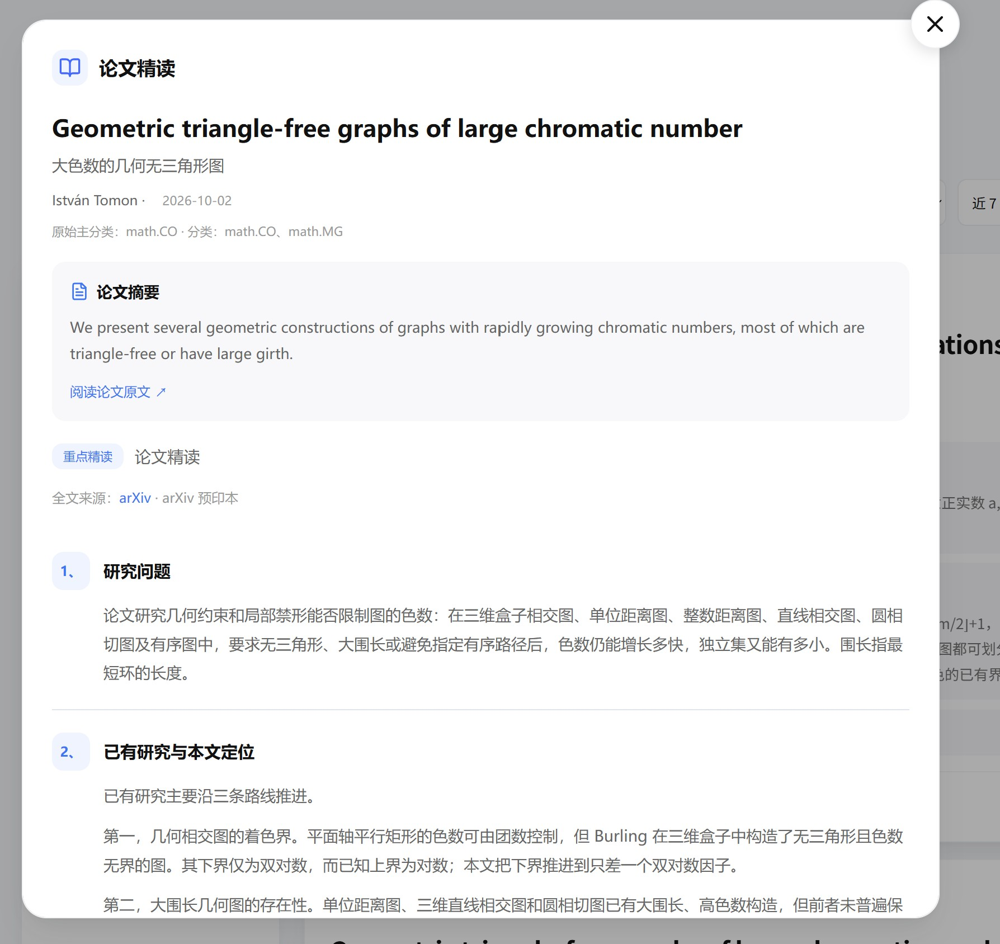

# Paper reading

[Contents](index.md) · [简体中文](../zh/reading.md)

## What a reading card provides

The two-part brief on a paper card helps you judge relevance quickly. A reading card answers six questions using the full text. These are separate results.

Open **展开**, then select **生成精读卡**. Generation requires login and an administrator-assigned reading model. A completed card is shared with subsequent users viewing the same paper.

## Six questions

| Section | Focus |
| --- | --- |
| 研究问题 | Problem, background, and difficulty |
| 已有研究与本文定位 | Prior work and the paper's distinction |
| 核心方法 | Steps, definitions, formulas, and assumptions |
| 关键结果与证据 | Empirical or theoretical results and supporting material |
| 后续研究方向 | Author-proposed directions and further questions |
| 核心总结 | A concise account of the paper's value |

**论文精读** is L2 and **深度解析** is L3. L3 has a separate model assignment and supports deeper method and evidence analysis; the level alone does not establish greater reliability.

## Generation workflow

Accepted requests enter a database queue. The worker obtains a concurrency slot, retrieves and parses full text, calls the model, and checks and saves the result. Ordinary papers use the full text directly. Papers beyond the usable context are organized in sections before final analysis.

Completed answers appear progressively. Model reasoning is hidden; the thinking stage shows status and elapsed time rather than an estimated percentage.

| Status | Meaning | Action |
| --- | --- | --- |
| 排队中，前面还有 N 位 | N waiting jobs are ahead in the same resource queue | Close the page and return later if desired |
| Material preparation | Retrieving, parsing, or organizing full text | Wait for preparation |
| Thinking / generating | The model is processing and returning displayable content | Check elapsed time and completed questions |
| Checking / ready | Evidence is being checked and the card saved | Read answers and evidence |
| Failed | Network, full-text, model, or parsing failure | Review the error and use the available retry control |

The queue count is not a time estimate and does not count every active generation job. Paper length and model latency vary.

## Asynchronous work and shared cache

- Closing the dialog, navigating away, or disconnecting your browser does not cancel an accepted request.
- Duplicate requests for the same paper reuse the current task and then its completed cache.
- A completed L3 card can satisfy a shallower request. Requesting L3 after L2 may trigger an upgrade.
- Waiting jobs survive a worker restart. Jobs interrupted during model execution are marked as interrupted and require retry.
- Administrators control regeneration of shared cached results; ordinary users cannot freely overwrite them.

**Top 5 预读** prepares selected recommended papers ahead of time. It shares reading capacity with user requests.

## Mathematics, tables, and evidence

Answers support Markdown lists, tables, and LaTeX mathematics. Expand **关键结果与原文证据** to inspect excerpts and verification markers.

A verified excerpt means that a corresponding passage was found in the full text. It is not proof of the scientific claim. Check unverified excerpts against the original. If the full-text source is an arXiv preprint, its content may differ from the final conference version.

## Administrator concurrency settings

Open Admin → **模型配置 → 功能分配** and the shared reading / deep-analysis concurrency settings. Defaults are two cloud / Codex cards and one local card. Adjust for provider limits and hardware. Reading, deep analysis, and prereading share this capacity.

[Previous: Interests and account settings](interests.md) · [Next: Research assistant and Skills](assistant.md)
