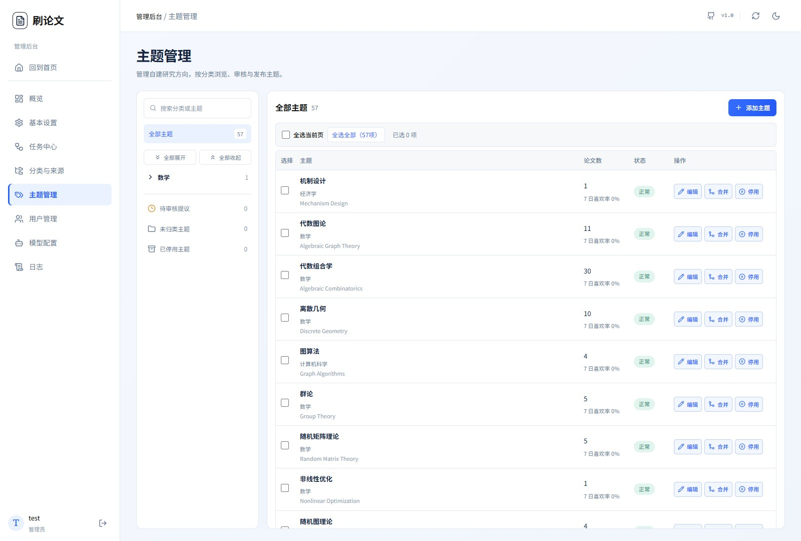

# Categories, sources, and topics

[Contents](index.md) · [简体中文](../zh/sources-topics.md)

## Three concepts

| Concept | Example | Purpose |
| --- | --- | --- |
| Discipline | Mathematics, Computer Science | Organize directions and sources |
| Source category | `math.CO`, `cs.LG`, ICML | Control ingestion and source labels |
| Research topic | Ramsey theory, reinforcement learning | Describe the paper's most relevant direction |

The current version uses a site **research-direction catalog** with bundled candidates and administrator-managed or approved additions. A candidate entry is not an already published topic. Fresh installations still require source configuration and topic addition or approval. Historical MSC / ACM descriptions from older versions do not directly describe the current catalog.

## Categories and sources

Open Admin → **分类与来源**. The list supports search, pagination, selection, and batch management.

### Add arXiv categories

1. Open the arXiv addition control.
2. Select entries from the category catalog, individually or in a batch.
3. Set automatic ingestion, guest defaults, and available ordering fields.
4. Save and run ingestion in the task center.

Adding a source does not immediately ingest all historical papers or create topic labels. Normal incremental work pages through synchronization windows; the initial trial has a separate quantity limit.

### Add conferences

Choose a conference catalog entry or enter a conference code and supported feed as provided by the form. Example: `https://papers.cool/venue/AAAI/feed`. Test the source before saving to inspect the year, count, and example titles.

Synchronization targets the latest edition available from the source, rather than every historical year. A conference paper uses its conference as the source category, such as ICML, instead of a generic `cs.AI` label. A paper can also have other registered source associations.

### Edit and batch-manage

Edit names, ingestion settings, guest defaults, and other supported fields. Select multiple entries to update ingestion or guest defaults, or begin a batch deletion. Turning off ingestion retains existing papers. Turning off guest defaults changes the public source scope.

### Delete sources

Review the impact preview and the paper deletion/retention counts before entering the required confirmation.

- Papers exclusive to the deleted sources, with no retained source association, are deleted.
- Papers associated with another retained source remain; deleted associations and labels are adjusted.
- Deletion runs in the background. Check progress and use the available retry control after a failure.

> Source deletion can remove papers, caches, labels, and personal references. It differs from disabling a topic. Back up before deleting.

## Topic management

The source tree sits beside a paginated topic list with search, status filters, and batch actions. On mobile, open the collapsible topic-tree drawer.

### Add or approve

Ordinary users choose catalog entries and submit proposals. The Agent can propose an existing direction or a new one; the console identifies the proposal source.

For approval, open the pending list, inspect the Chinese/English names, description, and source associations, then select **批准**. Edit and save corrections first, or reject an unsuitable proposal.

To add a topic directly as an administrator:

1. Open the new-topic control.
2. Enter a Chinese name, such as “Ramsey 理论”.
3. Enter the English name, such as `Ramsey Theory`.
4. Select a discipline, such as Mathematics.
5. Enter an English direction description, such as `Ramsey-type problems for graphs and hypergraphs.`.
6. Select source associations, such as `math.CO`, and save.

Each paper receives **one most relevant topic**. Approval attaches papers waiting for that topic; other papers may still require classification.

### Edit topics

Papers reference a topic by ID. Editing its displayed name or description changes the information shown after reloading, without regenerating label text for each paper.

Changing the scientific meaning is different from correcting the name. Reclassify affected papers when the new meaning no longer fits. Catalog information and topic-specific display edits can also be stored separately.

### Disable and permanently delete

| Action | Result |
| --- | --- |
| Disable / reject | Remove paper labels and interest references while retaining papers; block repeated proposals of the disabled direction |
| Restore / approve | Enable the topic and attach waiting papers according to current state |
| Permanently delete an archived topic | Remove the topic and its blocking record, allowing later Agent proposals; papers, likes, and saves remain |

Batch controls act on eligible selected states. Review the completed and failed items afterward.

[Previous: Administration](admin.md) · [Next: Models and Prompts](models-prompts.md)
