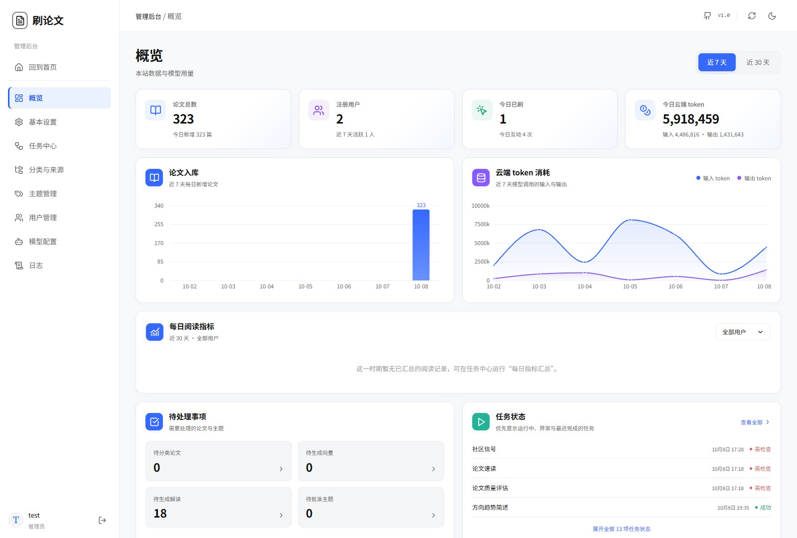

# 后台手册

[目录](index.md) · [English](../en/admin.md)

## 登录后台

管理员通过站点的安全入口访问后台。第一个账号注册后显示该随机地址，此后可在“基本设置”查看和修改。前台主菜单不提供后台入口。

打开入口后使用管理员账号登录。普通用户即使知道地址也不能使用管理功能；安全地址不替代身份认证。

## 菜单说明

| 菜单 | 作用 |
| --- | --- |
| 回到首页 | 返回前台 |
| 概览 | 查看站点规模、处理情况、用户行为及模型用量 |
| 基本设置 | 品牌、入口、缓存、日志保留与推荐参数 |
| 任务中心 | 运行、停止、禁用任务，配置计划和重做 |
| 分类与来源 | 管理 arXiv 分类、会议及抓取配置 |
| 主题管理 | 审核、添加、编辑、停用或删除主题 |
| 用户管理 | 修改账号、角色、状态及批量管理 |
| 模型配置 | 连接、功能分配、Prompts 和 Skills |
| 日志 | 排查接口、模型、来源及任务异常 |

后台用左侧菜单导航。手机端通过菜单按钮展开；“模型配置”的内部功能由横向子标签切换。

## 概览

概览以图表和统计展示论文、主题、用户、任务处理及云端 token 使用。输入、输出等用量来自模型调用记录与服务返回数据；模型未报告的值不能视为准确账单。实际费用和额度以服务商为准。

检查运行问题时，先看论文处理覆盖及任务状态，再到对应任务或日志定位。

## 基本设置

1. 修改网站名字和描述，上传网站图标、浏览器图标。
2. 设置安全管理入口。入口以 `/` 开头，之后为 6～80 位字母、数字、下划线或短横线，不能占用应用保留页面地址。
3. 按磁盘空间配置全文缓存保留天数和容量。
4. 设置运行日志保留天数及最大条数。
5. 按页面提供的推荐配置调整个人与游客排序权重，同一组权重合计为 100%。

每个图标文件最多 2 MB。保存后确认新入口可以访问，并更新书签。

日志默认保留 30 天。这个期限只管理日志记录，不会让 API Key 每 30 天失效。

## 用户管理

搜索和选择用户后，可以修改用户名、重置密码、授予或撤销管理员角色、启用或禁用账号。密码和角色等敏感变更会使原登录状态失效，用户需要重新登录。

多选后可批量处理账号。执行前核对所选对象和操作说明，尤其是批量删除。

| 操作 | 数据影响 |
| --- | --- |
| 禁用 | 阻止继续登录和使用账号，保留个人数据 |
| 重置密码 | 替换密码，原密码不可继续使用 |
| 设置管理员 | 获得站点管理权限，需提供安全入口给本人 |
| 删除 | 清理该用户的会话、兴趣、交互、监视、通知及个人技能等数据 |

系统阻止删除、禁用或降级当前登录管理员，并要求至少保留一个可用管理员。删除用户不会把本站共享论文全部删除。

## 日志

按日志页面提供的类别、级别和搜索条件定位事件。常见定位方式：

- 来源抓取失败：查看来源和任务事件。
- 模型生成失败：查看模型名称、功能、耗时及错误信息。
- 管理操作异常：查看操作路径、状态和关联记录。
- worker 未就绪：结合 Docker 的 worker 日志检查启动。

API Key、Authorization 等敏感字段会脱敏。日志不是完整数据库备份，保留策略也会清理旧记录。

[上一页：趋势和热点](trends.md) · [下一页：分类、来源与主题](sources-topics.md)
