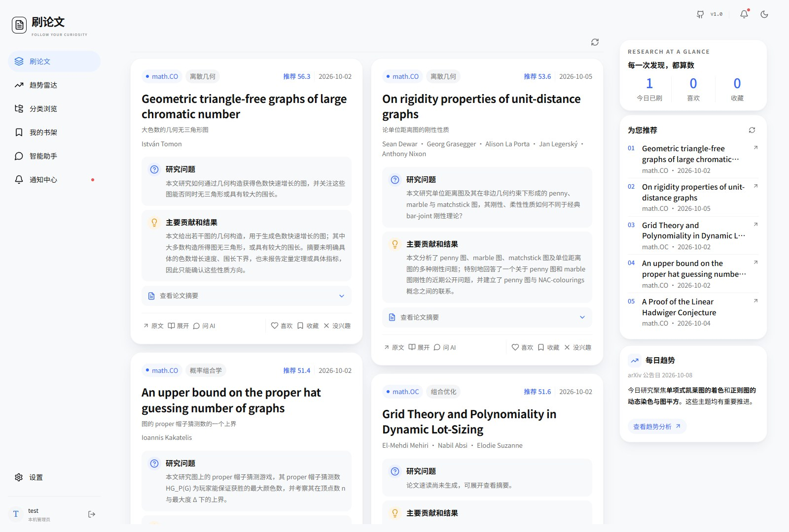

# Papers-Go 使用文档

[English](../en/index.md) · [文档首页](../index.md)

Papers-Go 将论文抓取、兴趣推荐、辅助阅读和研究趋势放在一个网站中。您可以自行部署，通过浏览器在电脑或手机上使用；模型既可以运行在本地，也可以调用云端服务。

本手册对应仓库版本 **1.1.1**，按安装者、研究者和管理员的实际使用流程组织。

## 开始使用

自行部署网站，请从[快速开始](quick-start.md)阅读：复制 Docker Compose、注册管理员、完成后台配置，再运行流水线并设置个人兴趣。

使用已经部署好的网站，请从[用户手册](user-guide.md)和[兴趣与个人设置](interests.md)开始。

## 完整目录

### 一、入门与部署

- [快速开始](quick-start.md)：从启动网站到完成配置、运行流水线和使用个人推荐。
- [环境部署](deployment.md)：Docker 部署、Ollama 与 GPU、访问地址和持久化目录。
- [配置说明](configuration.md)：环境变量、数据保存位置及配置生效方式。

### 二、后台配置

- [后台手册](admin.md)：管理入口、概览、基本设置、用户管理和日志。
- [模型配置](models-prompts.md)：云端 API、Ollama、Codex、功能分配及 Prompts。
- [分类、来源与主题](sources-topics.md)：添加 arXiv 分类和会议、审批主题、编辑与批量管理。
- [任务中心](pipeline.md)：运行完整流水线、设置计划、启用或禁用步骤、停止与重做。

### 三、前台使用

- [用户手册](user-guide.md)：刷论文、分类浏览、论文卡片操作和个人书架。
- [兴趣与个人设置](interests.md)：账户与外观、兴趣画像、主题提议、监视清单和通知。
- [论文精读](reading.md)：生成六问精读卡、查看排队状态和使用共享缓存。
- [智能助手与 Skills](assistant.md)：论文对话、会话管理、上下文与记忆、技能使用和管理。
- [趋势和热点](trends.md)：查看研究热点、个人方向进展及趋势生成状态。

### 四、维护与排错

- [运行维护](maintenance.md)：日常检查、版本更新、备份恢复和数据清理。
- [常见问题](faq.md)：部署、模型连接、流水线、推荐、精读等问题的处理方法。

### 五、开发与文档维护

- [本地开发](development.md)：使用 Conda 运行源码、启动前后端及工作进程。
- [文档维护与发布](publishing.md)：修改中英文文档，使用 VitePress 和 GitHub Pages 发布文档站。

## 系统角色

| 角色 | 主要操作 |
| --- | --- |
| 游客 | 浏览默认论文信息流、分类和论文信息；个人功能会提示登录 |
| 注册用户 | 设置兴趣，喜欢和收藏论文，生成精读卡，使用智能助手，提交主题或共享技能提议 |
| 管理员 | 配置模型和站点，维护来源、主题和用户，控制后台任务，查看日志及用量 |

第一个注册账号自动成为管理员。管理入口在首次注册成功后随机生成并提示，之后由管理员在后台查看和修改。

## 主要功能

- **刷论文**：桌面信息流、手机上下切换，论文卡显示速读、作者、分类及推荐分。
- **论文精读**：根据全文生成六问分析，支持数学公式、表格和原文证据；任务排队执行，结果共享缓存。
- **兴趣推荐**：结合所选分类、主题、长期兴趣、近期关注和阅读反馈进行排序。
- **趋势和热点**：围绕最新一期 arXiv 公告，展示热点及用户关注方向的研究进展。
- **智能助手**：检索论文、请求精读、理解用户兴趣，并按需使用个人或共享技能。
- **管理后台**：管理任务、分类来源、主题、账号、模型、指令和运行日志。

## 阅读约定

“后台 → 模型配置 → 功能分配”表示按顺序打开相应菜单。命令中的工作目录会在正文说明。`localhost:8000` 是默认 Docker 地址，更改端口后请使用实际地址。

英文文档与中文文档具有对应章节。截图沿用现有中文界面，英文手册保留中文菜单名供对照。文档语言与应用界面语言相互独立。

[下一步：快速开始](quick-start.md)
