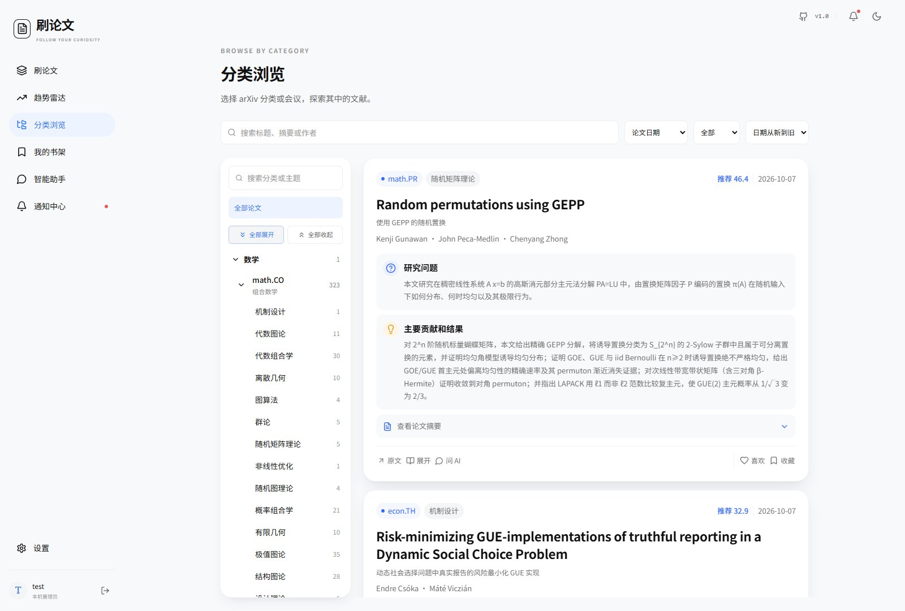

# 用户手册

[目录](index.md) · [English](../en/user-guide.md)

## 刷论文

入口：网站首页“刷论文”。游客可以直接浏览管理员配置的默认来源，设置个人兴趣、保存反馈等功能需要登录。

电脑端采用信息流，页面框架固定，中间内容独立滚动；手机端上下切换论文。信息流分批加载，初始批次为 20 篇，继续浏览时获取后续内容。

### 阅读论文卡

| 内容 | 说明 |
| --- | --- |
| 大标题 | 论文原标题 |
| 下方译名 | 论文速读任务生成的中文标题 |
| 作者 | 尽量完整显示，最多两行，超出时以“等”收尾 |
| 来源标签 | arXiv 分类代码或会议名称，例如 `math.CO`、ICML |
| 主题 | 已批准的研究主题，长名称在限定区域展示 |
| 推荐分 | 当前排序使用的综合分，不是论文录用概率或严格学术评级 |
| 研究问题 | 论文要解决什么问题 |
| 主要贡献和结果 | 方法、贡献及主要结论的短说明 |

尚未完成速读或分类的论文可能缺少译名、解读或主题。LaTeX 公式在支持的文本区域按数学形式显示。

### 操作按钮

- **原文**：打开论文来源页面。
- **展开**：查看论文详情、摘要，并进入精读。
- **问 AI**：带着论文上下文进入智能助手。
- **喜欢**：表达兴趣，用于推荐反馈，也可以在书架找到。
- **收藏**：保存到个人书架。
- **没兴趣**：表达负反馈，减少后续相关推荐。

喜欢和收藏可以取消。首页论文在可见区域连续停留达到约 **5 秒**才记录为已刷；只被加载或瞬间划过不算完成阅读。这个记录是浏览行为指标，不代表读完全文。

## 分类浏览

入口：“分类浏览”。

1. 在左侧选择 arXiv 分类或会议，展开查看已批准的主题。
2. 输入标题、摘要或作者关键词。
3. 按页面提供的日期口径和时间范围筛选。
4. 选择推荐分或日期排序。
5. 使用列表底部的上一页、下一页切换结果；分类列表每页 30 篇。

分类树与论文列表分别滚动。手机端点击分类入口打开抽屉，选择后回到列表。分类页分页与首页连续信息流是不同的浏览方式。

“最近收录”表示进入本站的时间；论文日期表示可取得的论文公开时间。旧论文新收录不等于刚发表。筛选不到结果时，先放宽时间范围和主题条件。

## 我的书架

登录后打开“我的书架”，按 **喜欢、收藏、浏览记录**查看个人论文，支持搜索标题、摘要或作者。

取消收藏只移除自己的收藏记录，不删除共享论文。管理员删除来源中的独属论文或执行到期清退后，该论文可能不再可用；个人收藏不等同于永久归档。

## 首页右侧

| 模块 | 用途 |
| --- | --- |
| 每一次发现，都算数 | 展示今日阅读、喜欢和收藏统计 |
| 猜你想看 | 展示最多 5 篇当前推荐论文 |
| 每日趋势 | 展示简版研究概述，跳转到趋势页查看完整内容 |

游客的趋势模块提示登录。桌面侧栏内容在较窄或手机布局下会调整位置或收起。

接下来建议完成[兴趣设置](interests.md)，提高推荐与关注方向的关联度。

[上一页：配置说明](configuration.md) · [下一页：兴趣与个人设置](interests.md)
